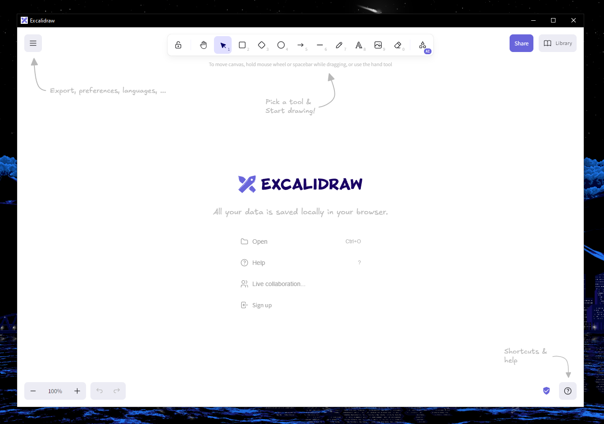

# excalidraw-desktop
Unofficial desktop client for Excalidraw on Windows, macOS, and Linux. It is just an electron wrapper for the website, I made this because I don't want to use it in a tab.

> **Offline:** The app loads the live [excalidraw.com](https://excalidraw.com). After one online launch, its service worker caches the app and every font, so later launches work offline. If excalidraw.com cannot load at all (for example, a first launch without a connection), the app falls back to a bundled copy of Excalidraw. The bundled copy keeps its own library and preferences, and live collaboration and share links still need a connection.



## Installation
Head over to the [Releases](https://github.com/pgkt04/excalidraw-desktop/releases/) page and download the appropriate installer for your operating system:

| Platform | Format |
|----------|--------|
| macOS | `.dmg` (Apple Silicon) |
| Windows | Setup `.exe` or Portable `.exe` |
| Linux | `.AppImage` or `.deb` |

### macOS
If you get the error "Is Damaged and Can't Be Opened. You Should Move It To The Bin", run:
```bash
xattr -c /Applications/Excalidraw.app
```
This is because I don't have a developer certificate and it's not notarized.

### Linux (AppImage)
After downloading, make the AppImage executable:
```bash
chmod +x Excalidraw-*.AppImage
./Excalidraw-*.AppImage
```

## File Association
The app registers itself as a handler for `.excalidraw` files. You can double-click any `.excalidraw` file to open it directly in the app. On Windows (NSIS installer), you'll be prompted during installation; on macOS and Linux, it's automatic.

## Development
Before building the project, ensure you have the following prerequisites installed:

- Node.js (version 22.12.0 or higher)
- npm (comes with Node.js)

Clone the repository:
```bash
git clone https://github.com/pgkt04/excalidraw-desktop.git
cd excalidraw-desktop
```

Install the dependencies:
```bash
npm install
```

Build the bundled offline fallback (a pinned [excalidraw-app](https://github.com/excalidraw/excalidraw/tree/master/excalidraw-app) commit, set in `scripts/build-excalidraw.js`, built into `app-bundle/`):
```bash
npm run build:excalidraw
```
It needs git and a network connection, and fetches yarn through `npx`. The `dist` scripts run it first. Without `app-bundle/`, `npm start` has no offline fallback.

### Running
To run the app in development mode:
```bash
npm start
```

### Building
To create a production build:

| Command | Platform | Output |
|---------|----------|--------|
| `npm run dist` | Current OS | Depends on platform |
| `npm run dist:mac` | macOS | `.dmg` (arm64) |
| `npm run dist:win` | Windows | Portable `.exe` + NSIS Setup `.exe` |
| `npm run dist:linux` | Linux | `.AppImage` + `.deb` |

The generated installers will be in the `dist/` folder.
